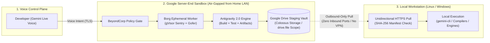

# Air-Gapped Cloud-Drive Relay (AGCDR)

**A Zero-Tunnel Architecture for Voice-Driven Cloud Coding on Google Gemini, Antigravity, and Google Drive**

**Author:** Dino Silvestri  
**Date:** November 2026  
**Status:** Architectural Proposal / Open RFC  
**Target Ecosystem:** Google Gemini Live, Google Antigravity 2.0, Google Drive (Colossus), `@google/gemini-cli`

---

## Executive Summary

Competing AI platforms in late 2026 connect mobile voice and chat interfaces directly to users' home computers through persistent desktop daemons, SSH keys, or mesh VPN tunnels such as Tailscale. While direct remote execution removes manual file-transfer steps, it breaks physical isolation between multi-tenant cloud AI infrastructure and untrusted consumer hardware.

**Google should reject direct cloud-to-PC tunneling.** Google operates foundational internet infrastructure—including Google Public DNS (`8.8.8.8` and `8.8.4.4`), Borg cluster orchestration, BeyondCorp Zero Trust gateways, and the Colossus distributed filesystem. Opening bidirectional execution channels between Google's production servers and millions of consumer PCs introduces unacceptable reverse-pivot exposure for Google and severe local-hardware risk for users if a cloud agent suffers prompt injection.

Instead, Google already owns the infrastructure to deliver a **faster, safer alternative**: execute voice-directed coding tasks inside ephemeral, gVisor-sandboxed cloud workers at datacenter I/O speeds, commit verifiable artifact bundles directly to a scoped Google Drive staging folder over Colossus, and let the developer pull verified folders to a local Linux or Windows workstation on demand.

---

## Architecture Overview



---

## Why Google Should Reject Direct PC Tunnels

1. **Protecting Critical Internet Infrastructure:** Google's network edge serves Google Public DNS (`8.8.8.8` / `8.8.4.4`), Workspace, Search, and Cloud. Maintaining persistent command-and-control relays into millions of unpatched home desktops violates BeyondCorp Zero Trust principles by binding production relays to unmanaged, untrusted endpoints.
2. **Containing Hijacked or Misaligned Agents:** An agent wired directly into a user's bare-metal Linux or Windows shell via Tailscale or SSH holds destructive local authority. A single indirect prompt injection inside a third-party dependency or web page can delete local files, exfiltrate SSH keys, or alter hardware thermal/sysfs configurations.
3. **Exploiting Datacenter Compute & Storage Velocity:** Streaming shell commands over residential upload links bottlenecks compilation and dependency resolution. Running builds inside Borg workers co-located with Colossus storage executes package installation, compilation, and artifact writing at internal datacenter throughput while the user speaks naturally on Gemini Live.
4. **Bridging the Post-Jules Gap:** With Google Jules entering read-only mode on November 11, 2026 ahead of its consolidation into Google Antigravity, developers need an asynchronous mobile-to-workstation workflow that does not require keeping a local IDE open or exposing home networks.

---

## Repository Contents

| Path | Description |
| :--- | :--- |
| [`docs/RFC-001-airgapped-drive-relay.md`](docs/RFC-001-airgapped-drive-relay.md) | Full Google-style Design Proposal covering Borg, gVisor (`runsc`), BeyondCorp, Colossus write paths, and Linux/Windows sync workflows. |
| [`docs/THREAT-MODEL.md`](docs/THREAT-MODEL.md) | Bidirectional security analysis detailing reverse-tunnel threats to Google infrastructure and rogue-agent threats to user hardware. |
| [`docs/COMPETITIVE-LANDSCAPE-2026.md`](docs/COMPETITIVE-LANDSCAPE-2026.md) | Architectural comparison against OpenAI Dots, Anthropic Claude Code Remote, Moonshot Kimi, Meta Muse, and xAI Grok Bot. |
| [`schemas/artifact-manifest.schema.json`](schemas/artifact-manifest.schema.json) | JSON Schema for cryptographically verifiable staging bundles written to Google Drive. |
| [`reference-cli/drive_pull_verify.py`](reference-cli/drive_pull_verify.py) | Reference Python client demonstrating unidirectional bundle validation and path-traversal protection before local CLI execution. |
| [`GROKBOT_PUBLISH.md`](GROKBOT_PUBLISH.md) | Automated instructions for an agent (such as Grok Bot or local CLI) to initialize and publish this repository to GitHub. |
| [`publish_to_github.sh`](publish_to_github.sh) | One-command shell script using `git` and `gh` CLI to create the public repository and push all commits. |

---

## Quick Verification (Reference Pull Verifier)

Run the included zero-dependency Python verifier self-test on Linux, macOS, or Windows:

```bash
python3 reference-cli/drive_pull_verify.py --self-test
```

Validate the sample manifest directly:

```bash
python3 reference-cli/drive_pull_verify.py --manifest reference-cli/sample-manifest.json --dry-run
```

---

## License

Released under the [Apache License 2.0](LICENSE).
