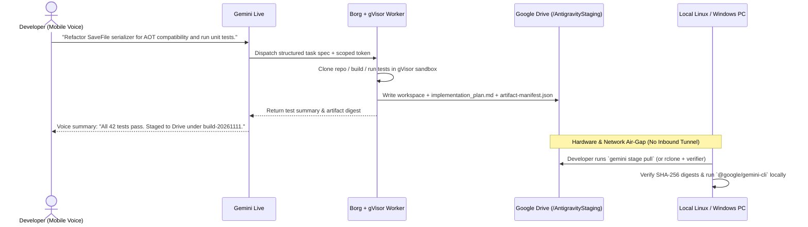

# RFC-001: Air-Gapped Cloud-Drive Relay for Gemini Live & Antigravity

- **Author:** Dino Silvestri
- **Created:** 2026-11-11
- **Status:** Draft Proposal
- **Component:** Gemini Live / Google Antigravity 2.0 / Google Drive API / `@google/gemini-cli`

---

## 1. Objective

Enable developers to direct multi-file software engineering tasks hands-free through **Gemini Live** (voice/mobile) and stage verified, ready-to-run build directories directly into a scoped **Google Drive** workspace—without opening inbound ports, SSH daemons, or mesh VPN tunnels (such as Tailscale) into the user's physical computer.

---

## 2. Background & Motivation

In late 2026, mobile-to-PC coding workflows split into two architectural camps:

1. **Direct Local Tunneling (Competitor Default):** Platforms pair a mobile app or cloud VM directly to the developer's home desktop via QR-paired daemons, SSH keys, or Tailscale tailnets. The agent mutates files and runs shell commands directly on local silicon.
2. **Cloud-Isolated Assistants (Current Consumer Gemini):** Gemini Live excels at low-latency voice reasoning and integrates with Google Workspace, yet lacks a native software-staging pipeline that hands clean, compiled, or Git-structured project folders off to a local Linux or Windows CLI environment. Meanwhile, Google Jules transitions to read-only status in November 2026 as agentic engineering consolidates into Google Antigravity.

Developers running Linux workstations (for example, Fedora/Nobara, Arch, or Debian) face high friction: Google provides no official native Linux Drive sync client, and Google Antigravity requires active local desktop presence to drive local filesystems. However, copying competitor tunneling models would undermine Google's strongest architectural advantage: **strict server-end isolation paired with hyperscale internal storage throughput**.

---

## 3. Design Principles

1. **Zero Inbound Workstation Trust:** Google servers initiate zero connections to user LANs, home routers, SSH ports, or virtual mesh networks.
2. **Server-End Execution Velocity:** Code generation, dependency resolution, test execution, and file writes happen on Google compute co-located with Google storage rather than traversing consumer last-mile broadband.
3. **Scoped Capability Storage (`drive.file`):** Cloud workers cannot read arbitrary personal files in a user's Google Drive. The sandbox receives a narrow capability token restricted exclusively to `/AntigravityStaging/<project-id>/`.
4. **Verifiable Handoff Artifacts:** Every staged run produces an Antigravity-compatible `implementation_plan.md`, test execution logs, and a signed `artifact-manifest.json` containing SHA-256 digests of every generated file.

---

## 4. Server-End Architecture (How Google Protects Its Infrastructure)

Google's internal stack makes an air-gapped cloud-staging workflow both safer and faster than remote local shells:

### 4.1 Compute Isolation: Borg + gVisor (`runsc`)
When a user initiates a coding session from Gemini Live, the orchestrator schedules an ephemeral worker pod on **Borg**. Rather than exposing a shared Linux host kernel to untrusted AI-generated code and third-party package install scripts, the container executes inside **gVisor**:
- **The Sentry (Userspace Application Kernel):** Intercepts and services application system calls in memory-safe userspace, blocking direct host-kernel syscall exploitation.
- **The Gofer (Filesystem Broker):** Enforces strict process-isolated filesystem boundaries so the coding agent can access only its ephemeral scratch volume.
- **Network Egress Policy:** Outbound traffic passes through an allowlisted proxy that blocks private RFC 1918 ranges, link-local metadata endpoints, and internal Google production networks.

### 4.2 Access Governance: BeyondCorp Zero Trust
Session authorization relies on **BeyondCorp** principles rather than network location:
- Voice commands in Gemini Live mint short-lived, task-scoped tokens tied to authenticated user identity and device posture.
- High-impact actions (such as publishing to an external Git remote or modifying staging retention policies) require explicit out-of-band confirmation on the user's mobile device.
- No VPN concentrator or reverse-SSH relay bridges consumer endpoints into Google's corporate or production planes.

### 4.3 High-Throughput Staging: Colossus Backing Google Drive
Unlike competitors that rent third-party object storage or stream diffs over residential TCP sockets, Google backs Drive storage with **Colossus** (Google's cluster-scale file system, coordinated by Curators and BigTable metadata with direct D-server I/O):
- **Internal Backbone Writes:** When the gVisor worker finishes building and testing a feature, it streams the workspace snapshot over Google's internal datacenter fabric directly into the user's Drive staging folder.
- **Atomic Manifest Commit:** The worker writes `artifact-manifest.json` last as an atomic commit marker so local pull tools never ingest half-written trees.

---

## 5. End-to-End Developer Workflow



### Step-by-Step Lifecycle
1. **Voice Briefing (Mobile):** While away from the desk, the developer talks through architectural constraints with Gemini Live.
2. **Cloud Synthesis & Verification (Server-End):** Gemini dispatches an asynchronous Antigravity background worker. The worker writes the code, runs linters and unit tests inside gVisor, and records verifiable artifacts.
3. **Drive Publication:** Output lands cleanly in `Google Drive:/AntigravityStaging/<project>/<run-id>/`.
4. **Local Pull & CLI Execution (Workstation):** At the workstation, the developer pulls the verified folder over outbound HTTPS (via native Drive Desktop on Windows/macOS, or a single `gemini stage pull` subcommand inside `@google/gemini-cli` on Linux) and executes local hardware-dependent workloads (GPU shaders, game engines, hardware-in-the-loop tests).

---

## 6. Eliminating Linux Friction Without Desktop Bloat

Linux developers frequently avoid mounting full cloud drives via FUSE due to sync latency and file-watcher noise during heavy compilation. Google does not need to ship a heavy GUI Drive sync daemon for Linux to solve this. Adding a native subcommand directly to `@google/gemini-cli` removes every manual hoop:

```bash
# Authenticate once with narrow drive.file scope
gemini auth login --drive-staging

# List completed voice-initiated cloud builds
gemini stage list

# Pull, verify SHA-256 manifest, and unpack into a clean Git worktree
gemini stage pull <run-id> --dest ./worktrees/aot-refactor
```

This keeps Linux workstations fast, avoids FUSE mount lag during builds, and preserves local execution performance.
