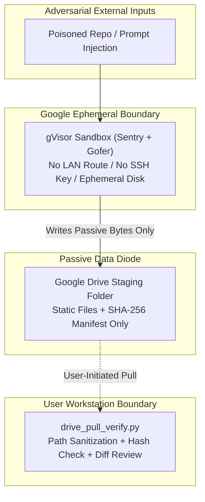

# Threat Model: Direct Cloud-to-PC Tunnels vs. Air-Gapped Drive Relay

This document analyzes the security boundaries of bidirectional AI agent tunnels compared to a unidirectional, cloud-staged relay.

---

## 1. System Assets at Stake

### 1.1 Provider-Side Assets (Google)
- **Foundational Internet Services:** Google Public DNS (`8.8.8.8` / `8.8.4.4`), Anycast routing edges, certificate authorities, and identity providers.
- **Multi-Tenant Compute & Storage Planes:** Borg job schedulers, Colossus storage clusters, Spanner metadata, and Gemini inference clusters.
- **Reputational & Systemic Trust:** Billions of consumer and enterprise endpoints rely on Google's AS15169 network integrity.

### 1.2 User-Side Assets (Developer Workstation)
- **Bare-Metal OS & Hardware Controls:** Kernel modules, GPU power/thermal sysfs overrides, bootloaders, and local storage partitions.
- **High-Value Credentials:** SSH private keys, GPG signing keys, browser session cookies, hardware wallet bridges, and `.env` production secrets.
- **Proprietary Source Trees:** Uncommitted local repositories, NDA assets, and commercial game/media builds.

---

## 2. Failure Modes of Direct Cloud-to-PC Tunnels

Competing architectures connect cloud-hosted agents to local PCs via outbound SSH from cloud VMs, mesh VPN nodes (such as Tailscale), or persistent local command-execution daemons. These designs introduce four structural hazards:

| Threat ID | Vector | Attack Mechanics | Impact |
| :--- | :--- | :--- | :--- |
| **T-01** | **Indirect Prompt Injection -> Local Wipe/Exfil** | Cloud agent reads an untrusted GitHub issue, web page, or README containing hidden adversarial instructions while holding an active shell tunnel to the user's PC. | Arbitrary command execution on bare metal (`rm -rf`, SSH key theft, silent backdoor persistence). |
| **T-02** | **Compromised Client -> Provider Relay Abuse** | Malware on an unpatched home PC hijacks the persistent bidirectional agent socket or mesh VPN peer to send malformed frames, exhaust relay state, or probe provider control planes. | Control-plane denial of service, parser exploitation, or lateral pivot attempts against cloud gateways. |
| **T-03** | **Cross-Agent Echo / Desynchronization Loops** | Multiple agents (for example, a mesh-tunneled bot driving a local CLI agent that simultaneously syncs back to a mobile companion app) trigger recursive tool invocations without a single kill switch. | Runaway API token burn, race-condition file corruption, and unattributed local mutations. |
| **T-04** | **Silent Ambient Authority** | Background desktop daemons (`Allow remote access`) retain broad user-level permissions 24/7, even when the developer is asleep or away from the keyboard. | Turns a transient cloud session compromise into permanent workstation compromise. |

---

## 3. How the Air-Gapped Drive Relay Mitigates Each Vector

1. **Containment of T-01 (Prompt Injection):** Even if an adversarial prompt hijacks the cloud coding agent during a voice-initiated build, the agent sits inside an ephemeral gVisor container with **zero network routes** to the developer's home PC and **zero access** to local `~/.ssh` or `~/.gnupg` directories. At worst, the compromised run writes bad code into an isolated staging subfolder—which the developer inspects via `git diff` before executing locally.
2. **Containment of T-02 (Provider Protection):** Google's production servers never join user tailnets, never maintain stateful SSH sessions to consumer routers, and never ingest raw reverse-shell streams. Traffic reduces to standard, battle-hardened Google Drive HTTPS API calls governed by BeyondCorp and Google Front End (GFE) infrastructure.
3. **Containment of T-03 & T-04 (Deterministic Pull):** Nothing changes on the local NVMe drive until the human runs an explicit pull command. The workstation exposes zero listening ports and runs zero background remote-control daemons.

---

## 4. Residual Risks & Required Safeguards

No architecture removes risk completely; defense-in-depth requires local verification controls:
- **Malicious Build Scripts in Pulled Code:** A compromised cloud run could write a malicious `Makefile` or `postinstall` hook into the staged folder. **Mitigation:** Local pull tooling must unpack staged files with execute bits stripped by default (`0644` for regular files unless explicitly allowlisted) and display a diff summary of executable or build-config files (`Makefile`, `package.json`, `.csproj`, `.github/workflows/*`) prior to local CLI execution.
- **Path Traversal (`Zip-Slip` / Symlink Escape):** Malformed archive paths (`../../etc/cron.d`) could attempt directory escape during local extraction. **Mitigation:** `drive_pull_verify.py` rejects absolute paths, `..` segments, and symbolic links before writing bytes to disk.
